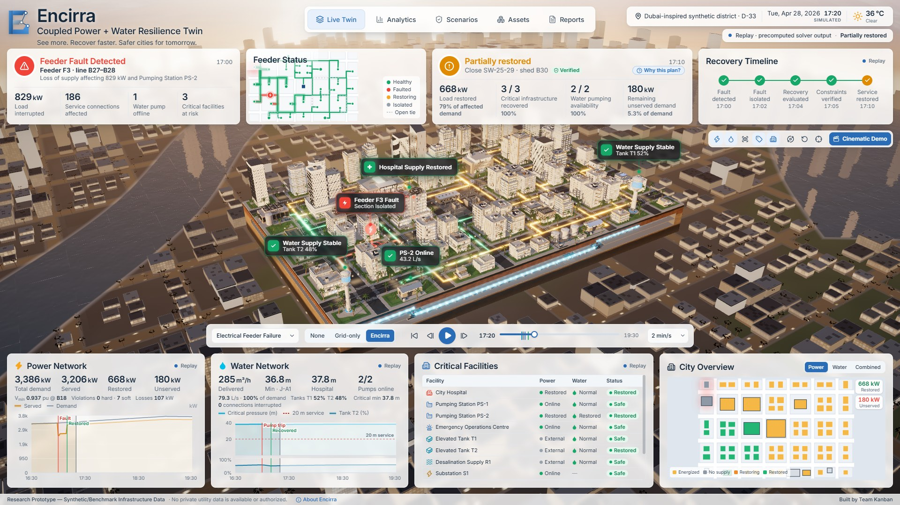
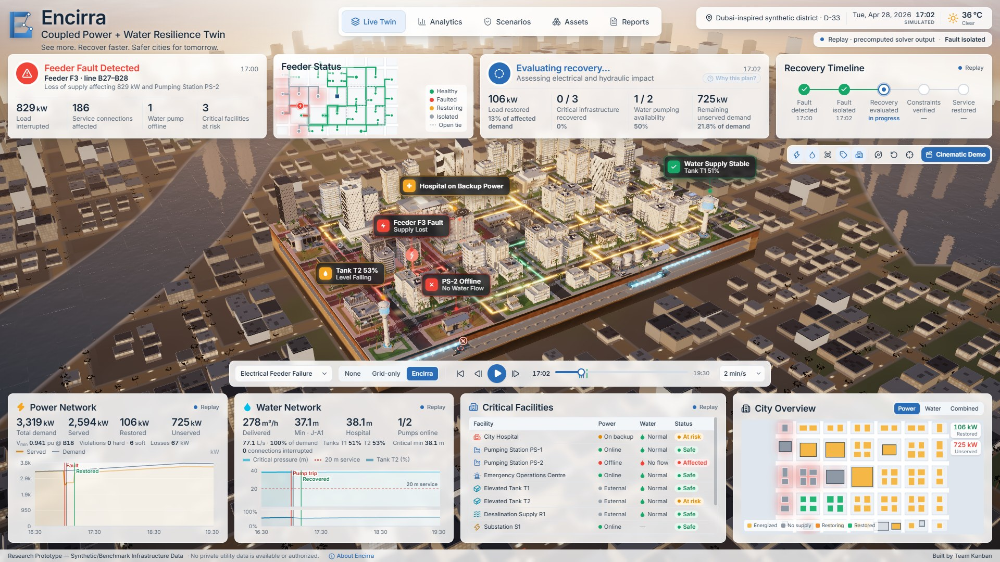
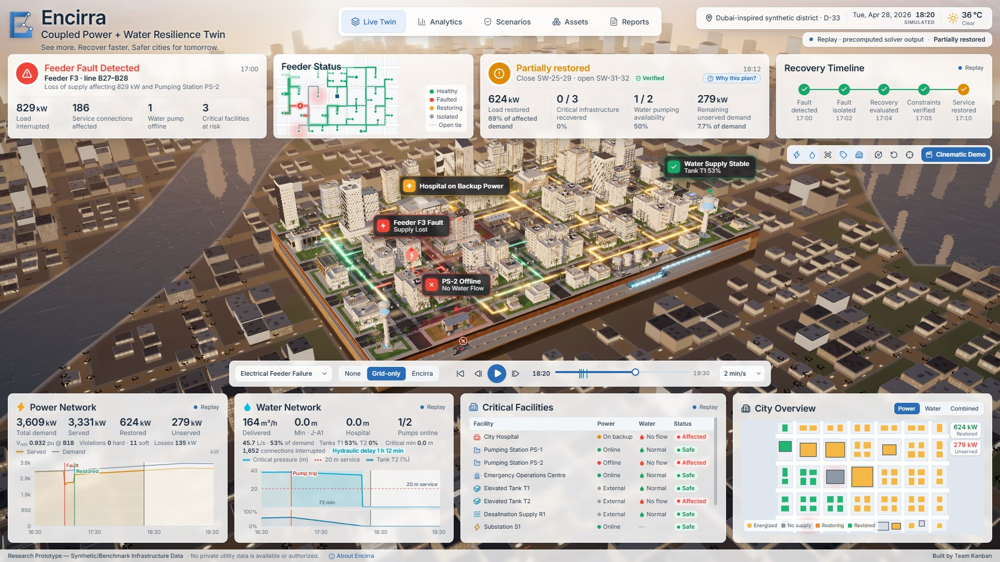
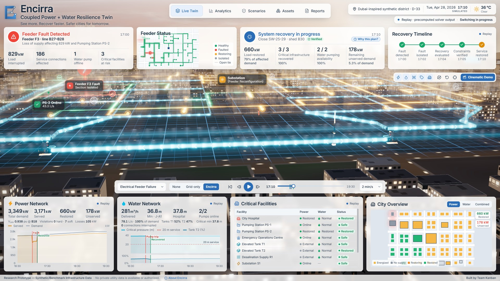
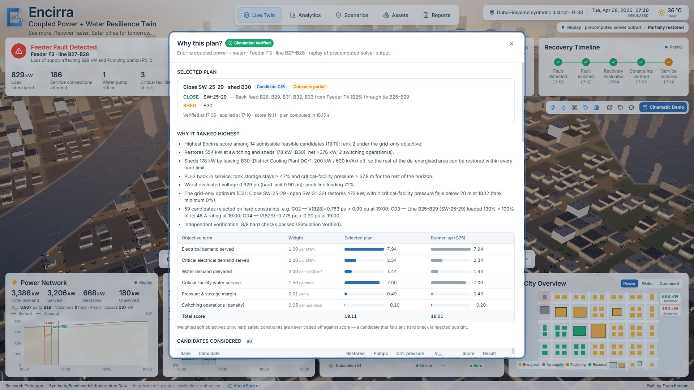
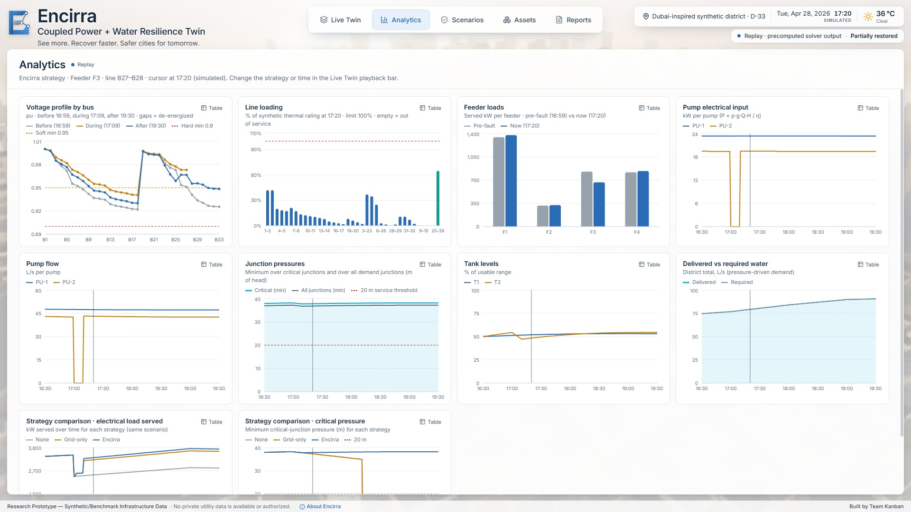
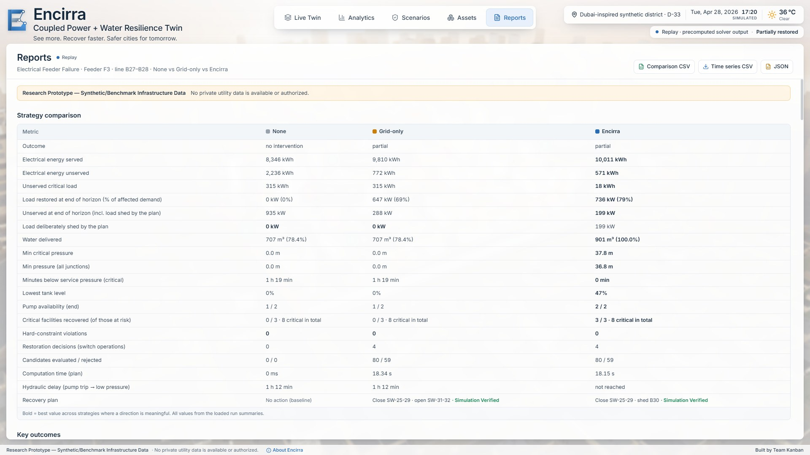

# Encirra

**Coupled Power + Water Resilience Twin** — *See more. Recover faster. Safer cities for tomorrow.*

Encirra is a physics-driven, optimization-assisted digital twin that models cascading failures between an
urban electrical distribution network and the water infrastructure that depends on it, then evaluates and
independently verifies safer recovery strategies.

**Live demo:** [encirra.kanbanstudios.ae](https://encirra.kanbanstudios.ae) — runs on the bundled replay of precomputed solver output.



> **Research Prototype — Synthetic/Benchmark Infrastructure Data.** The electrical model is the published
> IEEE 33-bus distribution test feeder (Baran & Wu, 1989); the water network, facilities, ratings, pump curves
> and demand profiles are synthetic. The district is Dubai-*inspired* only: no private utility data is available
> or authorized, and no real substation, pumping station, customer or live telemetry is represented.

Built for the IEEE NEECON 2026 Undergraduate Innovation Challenge.

---

## What it does

* **Coupled physics.** Every frame comes from a pandapower AC power flow of the IEEE 33-bus feeder and an
  EPANET 2.2 extended-period, pressure-driven hydraulic simulation (via WNTR). A pump runs only while its bus is
  energized; its electrical demand is computed from the hydraulic solution (P = ρ·g·Q·H / η) and fed back into
  the power flow until the two models agree.
* **Cascades you can see.** A Feeder F3 fault puts the hospital on its genset and stops Pumping Station PS-2.
  Elevated Tank T2 carries the West pressure zone for **72 minutes**; then hospital water pressure collapses.
  The delay is a result of the simulation, not an animation.
* **Three recovery strategies on identical physics** — no intervention, conventional grid-only restoration, and
  Encirra's cross-domain planner, which weighs electrical service, critical facilities, water delivered,
  pressure/storage margins and switching cost with visible, configurable weights.
* **Independent verification.** Every selected plan is re-simulated through a separate code path and checked
  against hard limits (power-flow convergence, 0.90–1.05 pu voltage band, thermal ratings, radiality and
  connectivity, fault isolation, pump supply, critical-facility pressure, tank minimum, switching feasibility).
  Only plans that pass every hard check are labelled **Simulation Verified**. Rejected candidates carry their
  physical reason, e.g. `V(B29)=0.775 pu < 0.90 pu` or `Line B25–B29 loaded 130 % > 100 %`.
* **A cinematic 3D twin.** A React Three Fiber district with an exposed underground water network, glowing
  feeder cables, state-driven lighting, labels and camera shots, built from an original procedural Blender kit.
* **Evidence for judges.** Analytics, a strategy comparison, a "Why this plan?" view with every candidate and
  check, CSV/JSON export, a methodology section and a 3-minute guided demo.

### Results (default scenarios)

| Scenario | Strategy | Plan | Net restoration | PS-2 at end | Hospital min. pressure | Minutes below 20 m |
|---|---|---|---:|---|---:|---:|
| Electrical feeder failure | None | — | 0 % | off | 0.0 m | 79 |
| | Grid-only | Close SW-25-29 · open SW-31-32 | 69.2 % | off | 0.0 m | 79 |
| | **Encirra** | Close SW-25-29 · shed B30 | **78.7 %** | **running** | **37.8 m** | **0** |
| Critical pump power loss | Grid-only | No further switching | 91.7 % | off | 0.0 m | 79 |
| | **Encirra** | Close SW-18-33 · shed B18 | 91.2 % | **running** | **37.8 m** | **0** |
| High-demand conditions | Grid-only / Encirra | Close SW-25-29 · shed B30 (same plan) | 78.6 % | running | 37.1 m | 0 |

All selected plans pass every hard check in a minute-by-minute re-simulation. The strategies converge under high
demand, and Encirra's advantage depends on the synthetic tie-line capacity; both findings are reported, with a
sensitivity analysis, in [docs/METHODOLOGY.md](docs/METHODOLOGY.md).

### Screenshots

| | |
|---|---|
|  |  |
| **Fault (17:02).** Protection has isolated Feeder F3; the hospital rides on its genset while PS-2 has stopped and Tank T2 starts to fall. | **Grid-only at 18:20.** The plan restores the most electrical load, but PS-2 stays dark: Tank T2 empties and hospital pressure falls to 0 m. |
|  |  |
| **Underground x-ray.** The surface fades to reveal mains, pumps and valves with live flow direction and pressure colouring. | **Why this plan?** Every candidate, its objective breakdown, the rejected alternatives with their failed checks, and the verification result. |
|  |  |
| **Analytics.** Voltage profiles, line loading, pump power and flow, pressures and tank levels. | **Reports.** None vs Grid-only vs Encirra, candidate evidence, methodology and CSV/JSON export. |

---

## Quick start

**Prerequisites:** Node.js ≥ 20 and npm; for the live solver, Python 3.11–3.13 with [uv](https://docs.astral.sh/uv/)
(a plain `venv` + `pip` fallback is built in). Optional: Microsoft Edge (end-to-end tests) and Blender 5.2
(asset rebuilds). Tested on Windows 11.

```bash
npm install            # front-end dependencies (all workspaces)
npm run setup:sim      # simulation dependencies (uv sync, or venv + pip)
npm run dev            # simulation API on :8000 + web app on http://127.0.0.1:5173
```

The web app also runs **without** the Python service: it falls back to the bundled replay of precomputed solver
output (`apps/web/public/replay/`), clearly labelled as a replay. Run `npm run dev:web` alone for a fully offline
demo.

| Task | Command |
|---|---|
| Start both services | `npm run dev` |
| Web app only (offline replay) | `npm run dev:web` |
| Simulation API only | `npm run dev:sim` |
| All unit/integration tests (web + simulation) | `npm test` |
| End-to-end browser tests (Edge, dev server running) | `npm run test:e2e` |
| Production front-end build | `npm run build` (preview: `npm run preview`) |
| Regenerate the replay bundle from the solvers | `npm run sim:export` |
| Regenerate layout + `docs/MAPPING.md` from the district config | `npm run layout` |
| Rebuild the Blender asset kit (headless) | `npm run assets:build` |
| Build and publish the hosted demo (Cloudflare Workers) | `npm run deploy` |

Environment variables are documented in [.env.example](.env.example).

> If `npm run dev` reports *Port 5173 is already in use*, another dev server is still running — stop it (or close its terminal) and run the command again.

**Hosting.** `npm run deploy` builds the app and publishes it with Wrangler as a Cloudflare Worker with static assets
([apps/web/wrangler.jsonc](apps/web/wrangler.jsonc)). The Python service is not hosted; the Worker answers `/api/health` with
`ok: false`, so the hosted site always runs on the labelled replay.

---

## Using the app

* **Live Twin** — the 3D district and live state. Press play (or step) to run the 16:30–19:30 scenario; switch
  strategy (None / Grid-only / Encirra) to compare outcomes on the same physics. Click the hospital, substation,
  pumping stations or tanks to inspect them. Toolbar: electrical / water / underground x-ray / labels / skyline
  layers, camera presets, auto-orbit, reset, and **Cinematic Demo** (the guided 3-minute sequence).
* **Analytics** — voltage profiles, line loading, feeder loads, pump power and flow, pressures, tank levels and
  strategy comparisons, each with a table view.
* **Scenarios** — the three disturbance scenarios, their parameters and the objective weights. With the solver
  running, parameters and weights recompute live.
* **Assets** — the modelled inventory (facilities, buildings, buses, lines, switches, pumps, pipes, tanks,
  junctions) with "Show in 3D".
* **Reports** — strategy comparison, candidate evaluation and verification evidence, methodology, assumptions,
  acknowledgments, and CSV/JSON export.

See [docs/USER_GUIDE.md](docs/USER_GUIDE.md) and the presenter script in [docs/DEMO_SCRIPT.md](docs/DEMO_SCRIPT.md).

---

## Architecture

```
apps/web/              React 19 + TypeScript + Vite + React Three Fiber dashboard and 3D twin
services/simulation/   Python: pandapower, WNTR/EPANET, NetworkX, OR-Tools, FastAPI, Pydantic
packages/shared/       Typed API contract, district configuration, deterministic layout generator
assets/blender/        Headless Blender build scripts and editable .blend sources
assets/models/         Optimized GLB asset kit + manifest (served at /models)
scenarios/             Scenario definitions
tests/e2e/             Browser tests (playwright-core + Edge)
scripts/               Dev runners, asset pipeline, QA capture tools
docs/                  Architecture, methodology, mapping, assets, demo script, user guide
```

* [docs/ARCHITECTURE.md](docs/ARCHITECTURE.md) — components and data flow
* [docs/METHODOLOGY.md](docs/METHODOLOGY.md) — models, coupling, objectives, verification, assumptions, limitations
* [docs/MAPPING.md](docs/MAPPING.md) — bus ↔ building ↔ water-node mapping (generated)
* [docs/ASSETS.md](docs/ASSETS.md) — 3D asset kit, conventions and rebuild steps

## Testing

* `npm run test:sim` — simulation suite: benchmark reproduction (Vmin 0.913 pu at B18, 202.7 kW losses), unit
  conversions, electrical–hydraulic coupling, topology changes, verification rejections, determinism, contract
  parity, API.
* `npm run test:web` — data adapters and selectors, cross-checked against the engine's summaries for every
  scenario × strategy.
* `npm run test:e2e` — launches Edge: navigation, 3D canvas, playback, strategy switch, "Why this plan?",
  exports, demo mode, the credit link, and console-error checks.

## Acknowledgments

pandapower · WNTR and EPA EPANET · NetworkX · Google OR-Tools · NumPy · SciPy · pandas · FastAPI · Pydantic ·
React · three.js · React Three Fiber · drei · postprocessing · Recharts · Lucide · Tailwind CSS · Motion ·
glTF-Transform / meshoptimizer · Blender. The IEEE 33-bus feeder is from M. E. Baran and F. F. Wu, "Network
reconfiguration in distribution systems for loss reduction and load balancing," *IEEE Trans. Power Delivery*,
1989. All 3D assets are original and generated procedurally for this project.

---

[Built by Team Kanban](https://kanbanstudios.ae/team-kanban)
