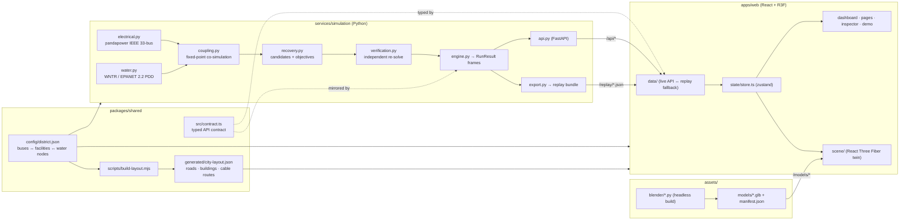

# Encirra — architecture

Encirra is a monorepo with one authoritative simulation service, one web client and a small shared
package that pins down the contract between them. Everything the user sees is either authoritative
simulation output or presentation state; the two are kept apart on purpose.

## Packages

| Path | Role |
|---|---|
| `packages/shared/config/district.json` | Single source of truth for the synthetic district: IEEE 33-bus bus numbering, feeders, switch kinds, synthetic ratings and voltage limits; facilities with their supply bus, water node and backup; the West/East water network (junctions, pipes, pumps, tanks, reservoir) with 3D routes. |
| `packages/shared/scripts/build-layout.mjs` | Deterministic generator (`npm run layout`) for roads, blocks, building placements (each building mapped to the bus that supplies it), palms, street lights, street-following cable routes, label anchors — and `docs/MAPPING.md`. |
| `packages/shared/src/contract.ts` | The wire format (`RunResult`, `Frame`, `CandidateEvaluation`, `VerificationReport`, …). The Pydantic models mirror it; `tests/test_contract_parity.py` guards key parity. |
| `services/simulation/` | Physics and decision engine. See [METHODOLOGY.md](METHODOLOGY.md). |
| `apps/web/` | Dashboard and 3D twin. |
| `assets/` | Procedural Blender asset kit, exported as meshopt-compressed GLBs. See [ASSETS.md](ASSETS.md). |
| `scenarios/` | Scenario definitions (`feeder-fault`, `pump-power-loss`, `high-demand`) with editable parameters. |

## Simulation service

* **Electrical** — `pandapower.networks.case33bw()` with an explicit switch on every line, synthetic
  thermal ratings, a declared time-of-day load profile, pump motor loads and per-bus shedding; AC
  Newton–Raphson power flow; energisation and radiality from the switch topology.
* **Hydraulic** — WNTR builds an EPANET 2.2 model from `district.json` (pressure-driven demand,
  20 m required / 0 m minimum pressure, 60 s hydraulic step) and runs an extended-period simulation
  with pump availability schedules.
* **Coupling** — a fixed-point (Gauss–Seidel) co-simulation: switching timeline → bus energisation →
  pump availability (undervoltage trip below 0.90 pu) → hydraulic EPS → pump power
  P = ρ·g·Q·H/η → AC power flow with pump loads → repeat until the pump schedule stops changing.
* **Recovery** — three strategies on identical physics (`none`, `grid-only`, `encirra`), a radial
  candidate set built from remote-operable switches plus optional non-critical load shedding, hard
  constraints that are never traded off, and a documented weighted objective for the soft preferences.
* **Verification** — the selected plan is re-simulated on freshly built networks through a separate
  code path; only a plan that passes every hard check is labelled *Simulation Verified*.
* **Delivery** — `api.py` (FastAPI: `/api/health`, `/api/topology`, `/api/scenarios`, `/api/run`,
  `/api/compare/{id}`, `/api/export/{id}.{json,csv}`) and `export.py`, which writes the offline replay
  bundle to `apps/web/public/replay/`. Results are cached per request hash.

## Web client

* **Data layer** (`src/data/`) probes `/api/health`. With the service running it requests live runs;
  otherwise — or while a live run is computing — it loads the replay bundle, which is labelled
  "Replay · precomputed solver output" everywhere it is shown.
* **Store** (`src/state/store.ts`) separates authoritative data (`topology`, `run`, `comparison`) from
  presentation state (page, selection, layers, camera requests, playback cursor, demo).
* **Playback** advances a fractional frame cursor; every card, chart, table, map and 3D element reads
  the same frame, so they cannot disagree.
* **Dashboard** (`src/app`, `src/dashboard`, `src/charts`, `src/maps`, `src/modals`, `src/inspector`,
  `src/pages`, `src/demo`) — the Live Twin overlay, Analytics, Scenarios, Assets and Reports pages,
  the "Why this plan?" evidence view and the scripted 3-minute demo.
* **3D twin** (`src/scene`) — React Three Fiber scene that loads the GLB kit via its manifest,
  instances buildings and props from `city-layout.json`, and drives window lighting, cable colours and
  energy flow, pipe flow and pressure colours, tank levels, labels and camera shots from the current
  frame.

## State machine

`ready → fault-detected → fault-isolated → impact-evaluated → candidates-generated →
verification-completed → recovery-applied → recovery-complete | partially-restored`
(`recovery-infeasible` when no candidate passes verification; `no-intervention` for the baseline).
The stage of every frame is computed by the engine and drives the cards, the timeline and the scene.

## Offline demo

`npm run sim:export` regenerates the replay bundle from the solvers. The web app needs nothing else to
run a full demonstration, so Demo Day does not depend on the Python service or network access.
